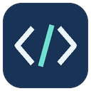

<a id="readme-top"></a>

<div align="center">
  <p>&nbsp;&nbsp;&nbsp;&nbsp;&nbsp;&nbsp;</p>

  <h1>Noah’s Tinycast Plugins</h1>

  <p>面向 macOS Tinycast 的插件集合，涵盖计算、编码转换、取色和密码库管理。</p>

  <p>
    <a href="https://github.com/NoahCodeGG/tinycast-plugins/actions/workflows/tinycast-install.yml">
      
    </a>
  </p>

  <p>
    <a href="#插件列表"><strong>查看插件</strong></a>
    ·
    <a href="#安装">安装指南</a>
    ·
    <a href="https://github.com/NoahCodeGG/tinycast-plugins/issues">反馈问题或建议</a>
  </p>
</div>

<details>
  <summary>目录</summary>

- [关于项目](#关于项目)
  - [技术栈](#技术栈)
- [快速开始](#快速开始)
  - [插件列表](#插件列表)
  - [安装](#安装)
- [使用](#使用)
- [构建与发布](#构建与发布)
- [反馈与贡献](#反馈与贡献)
- [第三方许可证](#第三方许可证)
- [致谢](#致谢)

</details>

## 关于项目

在 Tinycast 启动器里逐行计算、转换常见编码和时间戳、从屏幕取色，或浏览和编辑本地 KeePass 密码库。这些本地操作均可离线使用。每个插件可以单独安装。

### 技术栈

- 插件命令使用 TypeScript 和 React，通过 Tinycast 的 Raycast 兼容 API 运行。
- pnpm 管理工作区，esbuild 将命令打包为 CommonJS。
- 颜色助手使用 macOS AppKit 和 ImageIO 取色与读取图片。KDBX 密码库使用 Rust 辅助程序读写密码库。

## 快速开始

### 插件列表

发布工作流会根据已发布的插件清单同步本表。

<!-- tinycast-install-table:start -->

| 插件 | 主要功能 | 文档 | GitHub 安装目录 |
| --- | --- | --- | --- |
| 计算稿纸 | 逐行计算、复用结果并在本机保存多张稿纸。 | [使用说明](plugins/noah-calcpad/README.md) | [noah-calcpad](https://github.com/NoahCodeGG/tinycast-plugins/tree/tinycast-install/noah-calcpad) |
| 编码小助手 | 在本机转换文本、图片、时间戳和进制，生成 UUID 并计算文本和文件哈希。 | [使用说明](plugins/noah-codec/README.md) | [noah-codec](https://github.com/NoahCodeGG/tinycast-plugins/tree/tinycast-install/noah-codec) |
| 颜色助手 | 屏幕取色、转换色值、比较颜色，浏览色卡并生成配色和渐变。 | [使用说明](plugins/noah-color/README.md) | [noah-color](https://github.com/NoahCodeGG/tinycast-plugins/tree/tinycast-install/noah-color) |
| KDBX 密码库 | 在 Tinycast 内管理本地和 WebDAV KeePass 密码库，支持跨库搜索、备份及历史恢复。 | [使用说明](plugins/noah-kdbx/README.md) | [noah-kdbx](https://github.com/NoahCodeGG/tinycast-plugins/tree/tinycast-install/noah-kdbx) |

<!-- tinycast-install-table:end -->

### 安装

**从 GitHub 安装**

在 Tinycast 中打开 **Settings → Extensions → Install from GitHub**，粘贴上表中所需插件的安装目录链接。一次安装一个插件。此方式需要 Tinycast 能找到 Node.js 和一个包管理器。

Tinycast 匿名读取 GitHub。私有仓库可使用本地目录安装。

**从本地目录安装**

1. 解压插件 ZIP，或构建源码后找到对应插件的 `dist/`。用于导入的目录应包含 `package.json`、命令的 `.js` 文件和 `assets/`。
2. 在 Tinycast 设置中启用扩展，从 **Extensions → Install New → Add from folder** 选择该目录。导入预构建插件无需 Node.js 或 pnpm。

## 使用

安装后，在 Tinycast 启动器里搜索插件名称或命令。例如，运行「快速屏幕取色」，点击屏幕上的像素即可复制色值。各插件的命令、快捷键、配置方式和参考资料见上表的「使用说明」。

[返回顶部](#readme-top)

## 构建与发布

使用 Node.js 22+ 和 pnpm 10.12.1。构建所有插件需要 macOS、Xcode Command Line Tools 和 Rust 1.94+。

```sh
pnpm install --frozen-lockfile
pnpm typecheck
pnpm build
```

| 命令 | 用途 |
| --- | --- |
| `pnpm --filter <插件名> build` | 构建单个插件，产物放在对应插件的 `dist/`。 |
| `pnpm install:local <插件名>` | 将已构建的插件安装到本机 Tinycast。 |
| `pnpm package` | 用系统的 `zip` 命令在 `artifacts/` 生成带版本号的 ZIP，可直接分享或上传到 GitHub Release。 |
| `pnpm package:github` | 在 `artifacts/github-install/` 生成供 GitHub 安装的独立插件目录。 |

GitHub Actions 在 `main` 上的插件或构建文件更新后，将 GitHub 安装目录发布到 `tinycast-install` 分支，随后同步上方的插件列表。

插件命令位于 `plugins/<插件名>/src/commands/`，元数据位于 `plugins/<插件名>/src/manifest.json`，版本号由插件目录下的 `package.json` 定义。

## 反馈与贡献

反馈问题时，请附上插件名称、Tinycast 版本、复现步骤和预期结果。功能建议也可通过 [GitHub Issues](https://github.com/NoahCodeGG/tinycast-plugins/issues) 提交。

修改插件时，请在对应目录维护使用说明，运行类型检查和该插件的构建，然后提交 [Pull Request](https://github.com/NoahCodeGG/tinycast-plugins/pulls)。

## 第三方许可证

依赖与色卡数据的许可证随各插件维护，见插件文档中的「参考」章节。KDBX 辅助程序内置的依赖也保留了上游许可证。

## 致谢

- 插件运行环境由 [Tinycast](https://tinycast.dev/) 提供。目录结构和加载方式参考 [mimukit/tinycast-plugins](https://github.com/mimukit/tinycast-plugins)。
- 本页结构参考 [Best-README-Template](https://github.com/othneildrew/Best-README-Template)。
- 插件功能、数据和依赖的参考来源列在[各插件文档](#插件列表)中。

[返回顶部](#readme-top)
